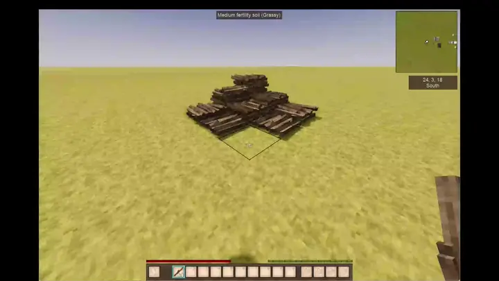

# Stick Piles

A simple Vintage Story mod that lets you stack sticks in **8 layers of 8 sticks** (up to **64 sticks** per block).

## Features
- Store up to **64 sticks** per block across 8 criss-cross layers.
- Scaling hitboxes that grow as you add more layers.
- Uses standard vanilla controls (**Right-Click** for 1 stick, **Sneak + Right-Click** for 8 sticks).

## Installation
Drop the `.zip` file into your Vintage Story `Mods` folder and enable **Stick Piles** in the Mod Manager.

> **Warning:** Tested on Windows only.